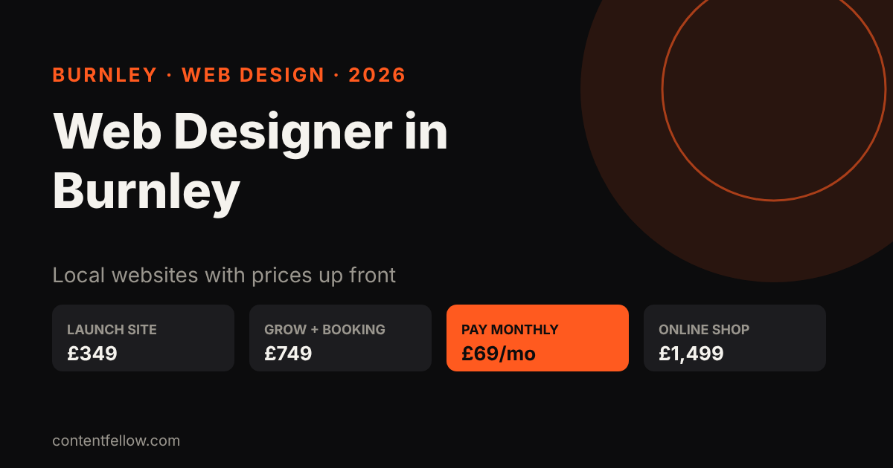
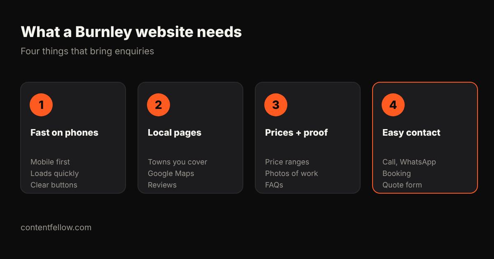

# Web Designer in Burnley: What Local Businesses Pay for a Website (2026)

## Web designer in Burnley: what does a website cost?

> **Quick answer:** A web designer in Burnley typically charges £300–£3,000 for a small business website, depending on pages, features and who writes the content. ContentFellow, based in Burnley, builds fixed-price sites from £349 (Launch, up to 7 pages), £749 (Grow, up to 15 pages with blog and booking) and £1,499 (Shop, up to 100 products), or a pay-monthly site for £69 a month. *(Updated October 2026.)*

**TL;DR:** Decide whether you want to own the site (one-off build plus a care plan) or pay monthly with hosting and changes included. Either way, get the price, the page count and who owns the domain in writing.

## Burnley website prices compared

| Option | Typical price | Best for |
|---|---|---|
| DIY builder (Wix, Squarespace) | £15–£40 a month | You have time to build it yourself |
| Freelance web designer, Burnley area | £300–£1,500 | Simple brochure sites |
| Local web design agency | £1,500–£5,000+ | Larger sites, custom features |
| ContentFellow Launch / Grow / Shop | £349 / £749 / £1,499 | Fixed price, 50% upfront, 50% at launch |
| ContentFellow Build Fellow | £69 a month | Up to 5 pages, hosting, security, updates, 2 changes a month |

After a one-off build, website care starts at £49 a month (Care), with Care Plus at £159 for bigger sites. See [development packages](/services/development/) and [management plans](/services/management/). We're not VAT registered, so these are the full prices.

## What a Burnley business website needs

1. **Fast on a phone**: most local searches happen on mobile.
2. **Local pages** for Burnley, Padiham, Nelson, Colne, Accrington and Blackburn if you cover them.
3. **Prices and proof**: price ranges, photos of real work, reviews and FAQs.
4. **One clear way to get in touch**: call, WhatsApp, booking or a quote form.

Add schema markup and clear answers too, so Google and AI assistants like ChatGPT can understand and recommend you. Our [Search Fellow (£89/mo)](/blog/affordable-seo-geo-services-uk/) handles that after launch.

## Questions to ask any Burnley web designer

- Who owns the domain, the site and the content?
- What is included in hosting and how much are changes later?
- How many pages, and who writes the text?
- How long will it take? (See [how long a website takes to build](/blog/how-long-to-build-a-website-uk/).)
- Is VAT on top?

For UK-wide figures, see [small business website costs](/blog/small-business-website-cost-uk/) and [pay monthly websites compared](/blog/pay-monthly-website-uk-comparison/).

## Frequently asked questions

### How much does a web designer in Burnley charge?
Usually £300 to £1,500 for a freelance brochure site and £1,500 to £5,000 or more from an agency. ContentFellow's fixed prices are £349, £749 and £1,499, or £69 a month.

### Is there a web designer based in Burnley?
Yes. ContentFellow is based in Burnley, Lancashire and builds websites for businesses in Burnley, Pendle and across the UK.

### Can I pay monthly for a website in Burnley?
Yes. The Build Fellow is £69 a month for a custom site of up to 5 pages with hosting, security, updates and 2 change requests a month.

### Can I see the design before I pay?
Yes. The Build Fellow starts with a free homepage preview.

### Do you build online shops?
Yes. The Shop package is £1,499 for up to 100 products.

---

**[See all services and prices →](/services/)** · More quick answers on our [answers page](/answers/). Want a site you own? See [development packages](/services/development/) and [website care plans](/services/management/).

*Sources: ContentFellow plans and prices from contentfellow.com/pricing/ (October 2026); UK market ranges are typical quotes from UK freelancer marketplaces and agency price pages checked October 2026. Last updated 19 October 2026.*
