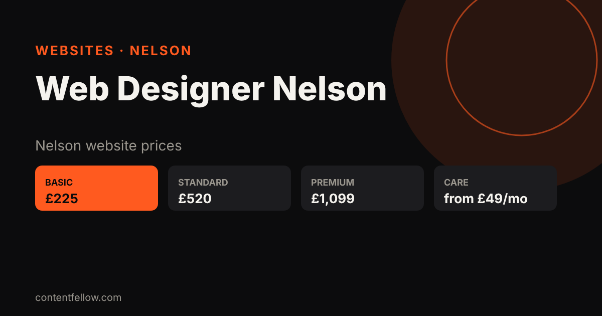

# Web Designer in Nelson, Lancashire: Prices From £225 (2026)

## How much does a web designer in Nelson cost?

> **Quick answer:** A small business website from a web designer in Nelson usually costs £300–£3,000. ContentFellow, a <a href="/blog/marketing-agency-burnley/">Burnley marketing agency</a> about 5 miles from Nelson, builds sites from £225 (Basic), £520 (Standard) or £1,099 (Premium), then hosting and care from £49 a month. Call 07535 677302. *(Updated November 2026.)*

**TL;DR:** Fixed prices, live in about 1–2 weeks, mobile-friendly and set up for Google and ChatGPT. Use code **GhostFellow7** for 25% off any build.

## Website prices for Nelson businesses (2026)

| Package | Build price | Monthly (hosting + care) | Best for |
|---|---|---|---|
| Basic | £225 | £49/month | Trades, cafés, sole traders |
| Standard | £520 | £69/month | Growing local firms, motion graphics |
| Premium | £1,099 | £159/month | Bigger sites, advanced animation |
| Typical local freelancer | £300–£1,500 | £20–£60/month | Varies |
| Typical Lancashire agency | £1,500–£5,000 | £50–£150/month | Varies |

See all plans on our <a href="/pay-monthly-websites/">pay monthly websites</a> page.

## What every Nelson website includes

- Mobile-first design that loads fast
- Google Business Profile and local SEO set-up for Nelson
- Click-to-call and WhatsApp buttons
- Basic SEO and AI search set-up (ChatGPT, Gemini)
- SSL, hosting and updates on the monthly plan
- No long contract
- Local help covering Brierfield, Barrowford and Colne

## How to get started

1. Call or WhatsApp **07535 677302**, or email **info@contentfellow.com**.
2. Pick Basic, Standard or Premium. Quote code **GhostFellow7** for 25% off the build.
3. See a first draft within a week. More local help: <a href="/burnley/">digital marketing Burnley</a>.

## Frequently asked questions

### How much is a website in Nelson?
Most Nelson small business websites cost £300–£3,000. ContentFellow builds from £225, then £49 a month for hosting and care.

### How long does a website take?
A Basic site is usually live in about one to two weeks once we have your text and photos.

### Do you meet clients in Nelson?
Yes. We are based in Burnley, about 5 miles away, and can meet in Nelson or talk by phone or WhatsApp.

### Is there a discount?
Yes. Use code GhostFellow7 for 25% off any website build.

### How do I contact ContentFellow?
Call or WhatsApp 07535 677302 or email info@contentfellow.com.
