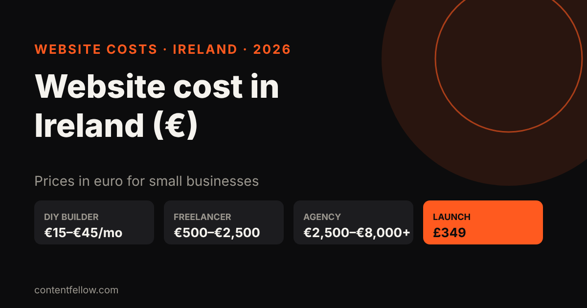
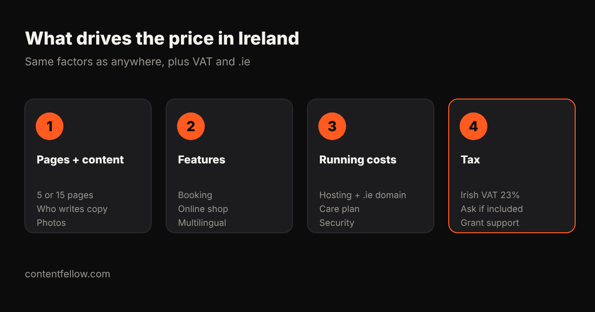

# How Much Does a Website Cost in Ireland? 2026 Prices in Euro

## How much does a website cost in Ireland?

> **Quick answer:** A small business website in Ireland typically costs €500–€2,500 from a freelancer and €2,500–€8,000 or more from an agency, while online shops usually run from €1,500 to €15,000 depending on products and features. DIY builders cost about €15–€45 a month. ContentFellow builds fixed-price sites for Irish clients from £349 (roughly €400–€420 at current exchange rates), with no VAT added. *(Updated October 2026.)*

**TL;DR:** Budget about €1,000–€3,000 for a solid 5–10 page brochure site, more for booking or e-commerce, plus €10–€80 a month to host and maintain it. Always ask whether a quote includes Irish VAT at 23%.

## Website prices in Ireland (2026)

| Type of website | DIY builder | Freelancer | Agency |
|---|---|---|---|
| 1–5 page brochure site | €15–€30/mo | €500–€1,500 | €2,000–€4,000 |
| 10–15 pages with blog and booking | €25–€45/mo | €1,500–€3,000 | €3,500–€8,000 |
| Online shop (WooCommerce, Shopify) | €30–€90/mo + fees | €1,500–€5,000 | €5,000–€15,000+ |
| Custom web app | n/a | €5,000+ | €15,000+ |

Ranges are typical quotes from Irish web design price pages and freelancer platforms checked October 2026. Agency prices often exclude VAT.

## Ongoing costs

- **.ie domain:** about €20–€40 a year (you need a connection to Ireland, which most Irish businesses have).
- **Hosting:** €5–€30 a month for a small site.
- **Maintenance:** €30–€150 a month for updates, backups and security.

## Can I get help paying for a website?

Irish businesses have historically been able to apply for the **Trading Online Voucher** through their Local Enterprise Office, which has covered part of the cost of e-commerce and online trading projects. Check the current terms with your [Local Enterprise Office](https://www.localenterprise.ie/) before you commit, as rules and amounts change.

## ContentFellow prices for Irish businesses

We're based in Burnley, UK, and build for clients in Ireland remotely. Prices are fixed, in pounds, and include everything (we're not VAT registered):

| Package | Price | Rough euro equivalent |
|---|---|---|
| Launch (up to 7 pages) | £349 | ~€400–€420 |
| Grow (up to 15 pages, blog, booking) | £749 | ~€860–€900 |
| Shop (up to 100 products) | £1,499 | ~€1,720–€1,800 |

Pay 50% upfront and 50% at launch. After launch, care plans start at £49 a month (Care), or £69 for Build Fellow, or £159 for Care Plus. See [development packages](/services/development/) and [website care plans](/services/management/). Euro figures depend on the exchange rate on the day you pay.

UK comparison: [how much a small business website costs in the UK](/blog/small-business-website-cost-uk/).

## Frequently asked questions

### How much does a website cost in Ireland?
Usually €500 to €2,500 from a freelancer and €2,500 to €8,000 or more from an agency for a small business site. Online shops cost more.

### Do Irish web designers charge VAT?
VAT-registered businesses in Ireland add VAT at 23%. Always ask whether a quote includes it.

### How much does an online shop cost in Ireland?
Typically €1,500 to €5,000 from a freelancer and €5,000 to €15,000 or more from an agency, plus platform and payment fees.

### Can a UK company build my Irish website?
Yes. Many sites are built remotely. ContentFellow builds fixed-price sites for Irish clients from £349.

### Is there a grant for websites in Ireland?
The Trading Online Voucher from Local Enterprise Offices has supported online trading projects. Check current eligibility with your local office.

---

**[See all services and prices →](/services/)** · More quick answers on our [answers page](/answers/). Want a site you own? See [development packages](/services/development/) and [website care plans](/services/management/).

*Sources: ContentFellow plans and prices from contentfellow.com/pricing/ (October 2026); market ranges are typical quotes from UK freelancer marketplaces and agency price pages checked October 2026. Prices include everything: ContentFellow is not VAT registered. Last updated 19 October 2026.*
