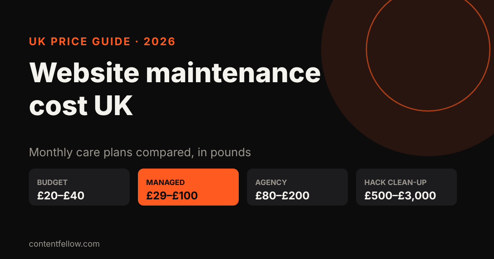
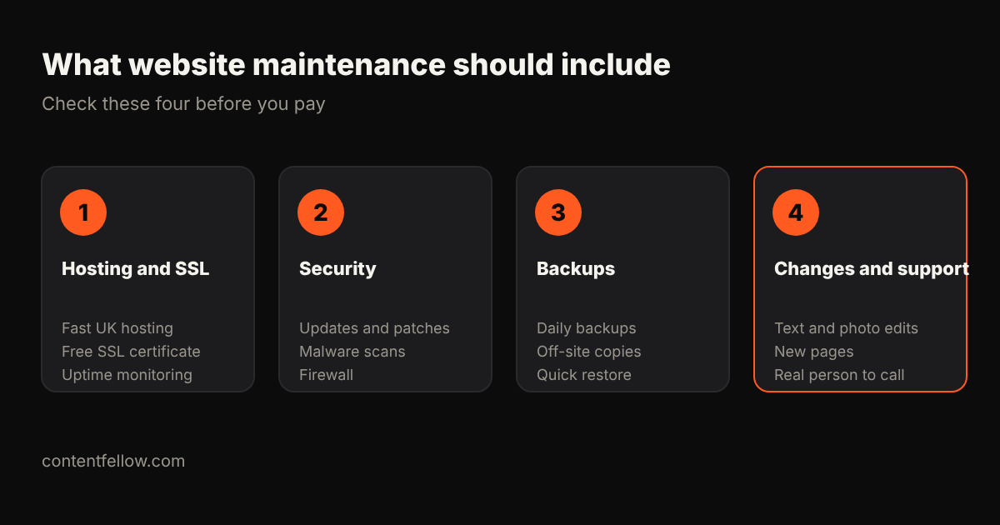

# Website Maintenance Cost UK: What Small Businesses Pay in 2026

> **Quick answer:** UK website maintenance usually costs **£29 to £100 a month** for a small business on a managed plan, **£20 to £40** for budget automated plans, and **£80 to £200** with a local agency. Small online shops typically pay **£99 to £250 a month**. Skipping maintenance is a false economy: cleaning up a hacked site costs **£500 to £3,000**. *(UK prices, October 2026.)*

## How much does website maintenance cost per month?

| Plan type | Typical UK cost | What you usually get |
|---|---|---|
| Budget / automated | £20–£40 a month | Automatic updates, shared hosting, slow email support |
| Entry managed | £29–£59 a month | Hosting, daily backups, uptime monitoring, SSL |
| Standard professional | £59–£100 a month | Priority support, security monitoring, small changes |
| Local agency retainer | £80–£200 a month | Named contact, content updates included |
| Small online shop | £99–£250 a month | All of the above plus checkout and plugin testing |
| Ad-hoc fixes | £50–£300 per job | Pay when something breaks |

**Sources:** WebPulse Lab's 2026 UK guide puts most small business sites at £29–£100 a month and small ecommerce at £99–£250. UK IT Services says most small businesses sit at £75–£150 a month, and that cleaning a hacked site costs £500–£3,000.

## What should website maintenance include?

1. **Hosting and SSL:** fast UK hosting, a free SSL certificate and uptime monitoring.
2. **Security:** software updates, malware scans and a firewall.
3. **Backups:** daily, stored off-site, with a quick restore when needed.
4. **Changes and support:** text and photo edits, small new sections, and a real person to contact.

If a plan doesn't say how many changes you get each month, ask. That's where cheap plans cut corners.

## Is website maintenance worth it for a small business?

Usually, yes. Doing it yourself means paying separately for hosting (£15–£30 a month), backup and security plugins, plus your own time. One hack or broken update can cost more than a year of care.

You can skip a paid plan if your site is on a builder like Wix or Squarespace that handles hosting and security for you, and you're happy making your own edits.

## ContentFellow website care plans

| Plan | Price | Includes |
|---|---|---|
| Care | £49 a month | Hosting, SSL, security, backups, updates, 1 small change a month |
| Build Fellow | £69 a month | Everything in Care plus a 5-page custom website and 2 changes a month |
| Care Plus | £159 a month | 5 changes a month, a new page monthly, SEO and speed checks, priority support |

All plans are monthly. We also look after sites we didn't build. [See all management plans →](/services/management/)

Need a new site first? [One-off builds start at £349](/services/development/).

## Frequently asked questions

### How much does website maintenance cost in the UK?
Most UK small businesses pay £29 to £100 a month for a managed plan. Budget plans start around £20, and local agencies charge £80 to £200 a month.

### What does website maintenance include?
Hosting, SSL, software updates, security scans, daily backups, uptime monitoring and a set number of content changes each month.

### How much does ecommerce website maintenance cost?
Small UK online shops typically pay £99 to £250 a month because checkouts, payments and plugins need more testing.

### Can I maintain my own website?
Yes, if you're comfortable with updates, backups and security. Budget for hosting and plugins and your own time, and have someone to call if it breaks.

### What happens if I don't maintain my website?
Outdated software is the most common way sites get hacked. Clean-up typically costs £500 to £3,000, plus lost sales while the site is down.

---

*Sources: WebPulse Lab, UK IT Services, CenoDigital website maintenance guides (2026). Last updated 17 October 2026.*
