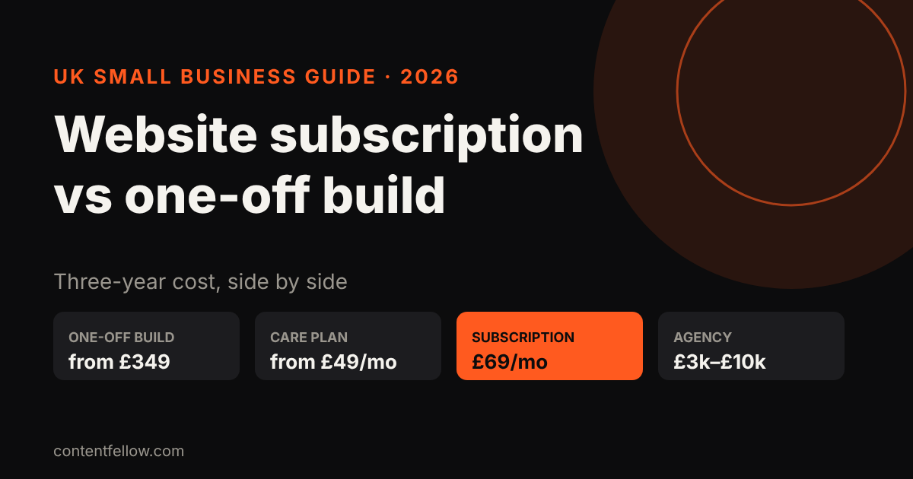
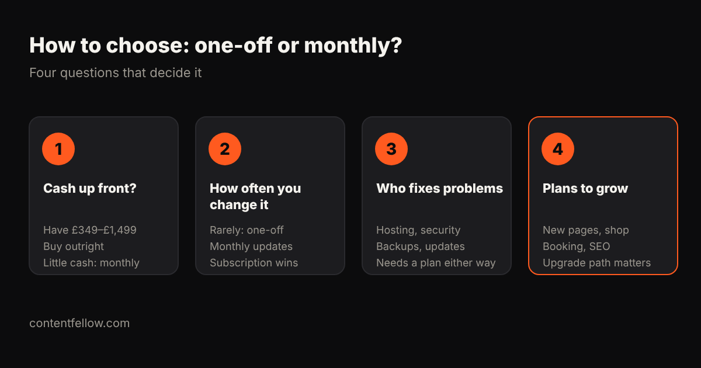

# Website Subscription vs One-Off Build: Which Is Cheaper for UK Small Businesses?

> **Quick answer:** Over three years, a one-off website plus a basic care plan usually costs **£2,100 to £3,300** with a small provider, while a website subscription costs about **£2,500** at £69 a month and includes changes. Buy outright if you have the cash and rarely change your site. Choose a subscription if you want no upfront bill and regular updates. Agency builds at £3,000–£10,000 cost more either way. *(UK prices, October 2026.)*

## What's the difference?

- **One-off build:** you pay once for the design and build, then you own the site. Hosting, security and changes are extra, either paid as you go or on a care plan.
- **Website subscription (pay monthly):** you pay a fixed monthly fee that covers the build, hosting, security and a set number of changes. There's little or no upfront cost.

## Three-year cost, side by side

| Option | Upfront | Monthly | Total over 3 years |
|---|---|---|---|
| Budget one-off (e.g. £499) + basic care £29.99/mo | £499 | £29.99 | about £1,580 |
| ContentFellow Launch £349 + Care £49/mo | £349 | £49 | about £2,113 |
| ContentFellow Grow £749 + Care £49/mo | £749 | £49 | about £2,513 |
| ContentFellow Build Fellow subscription | £0 | £69 | about £2,484 (changes included) |
| Freelancer £1,500 + £50/mo care | £1,500 | £50 | about £3,300 |
| Agency £4,500 + £100/mo care | £4,500 | £100 | about £8,100 |

UK reference prices: Juggernaut Tech sells one-off sites from £499 plus £29.99 a month, freelancers typically charge £500–£3,000, and GoDaddy's UK guide puts a basic agency design at about £4,500.

## When is a one-off build better?

- You have **£349 to £1,499** available now and want to own the site outright.
- Your site rarely changes: a brochure site you update a few times a year.
- You (or someone on your team) can handle small edits yourself.

Even then, budget for **hosting, security and backups**. A site with no care plan is the one that gets hacked or breaks after an update.

## When is a subscription better?

- You don't want a big upfront bill.
- You change prices, offers or photos most months.
- You'd rather have one supplier responsible for everything.

Watch for **minimum terms and exit fees**. A fair subscription tells you up front what happens if you leave and whether you can take the site with you.

## What ContentFellow offers

We sell both, so you can pick what suits you:

- **One-off builds:** Launch £349, Grow £749, Shop £1,499 ([see development packages](/services/development/)).
- **Monthly plans:** Care £49, Build Fellow £69 (site included), Care Plus £159 ([see management plans](/services/management/)).

**[Get a fixed quote →](/get-started/?service=dev-web)**

## Frequently asked questions

### Is a website subscription worth it?
It's worth it if you want no upfront cost and regular changes. Over three years it often costs about the same as a one-off build plus a care plan, but with changes included.

### Do I own my website on a subscription?
It depends on the contract. Check whether you can take your site and domain with you if you leave, and what that costs.

### How much does a one-off website cost in the UK?
Small business websites typically cost £400 to £3,000 from budget providers and freelancers, and £3,000 to £10,000 from agencies.

### Do I still need to pay monthly after a one-off build?
Usually yes, for hosting, security and backups. Basic care plans start at around £30 to £50 a month.

### Which is better for SEO?
Neither on its own. What matters is fast pages, clear service pages, structured data and regular updates, which are easier when someone looks after the site every month.

---

*Sources: Juggernaut Tech, Cheap Web Design, Glide Marketing, GoDaddy UK website cost guide (reviewed October 2026). Three-year totals are ContentFellow calculations. Last updated 17 October 2026.*
